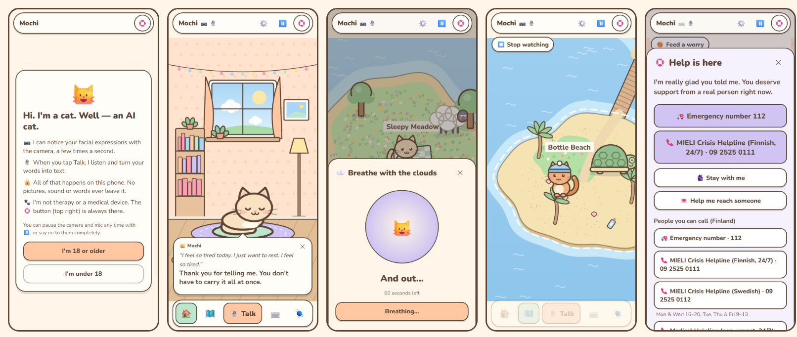

# 🐱 Mochi — a cat companion that notices how you are

**Mochi** is a cozy cat-companion web app for low-energy days, built at Junction. The cat reads your facial expressions and listens to what you say. It mirrors your energy, starts gentle conversations, leads you to calm places on a little world map, and always keeps help one tap away.

**All of it runs on your phone.** The face tracking and the speech-to-text are AI models running inside the browser. No pictures, audio or words are ever sent anywhere.

> Mochi is a self-care companion, **not** therapy, a crisis service or a medical device. If you are in danger, call your local emergency number (112 in Finland and the EU).

<p align="center"></p>

---

## ✨ What it does

- **🐾 Mirrors your energy.** The cat has five looks, from asleep in a box with a blanket (1) to zoomies around the room (5).
- **📷 Notices your face.** MediaPipe reads smile, frown, sad brows and eye openness about 3 times a second. A face is treated as a *hint*, never the truth.
- **🎙️ Talk to the cat.** Hold (or tap) **Talk**, and Whisper turns your speech into text on the device. The cat answers with a fitting, pre-written line. **⌨️ Type** works too.
- **💬 Asks first, gently.** The cat greets you, checks its guess ("You look a little sleepy… am I right?") or asks something playful ("Which blanket today?"). Your answer always wins, and **"Not now"** keeps it quiet for 15 minutes.
- **🗺️ "Follow me".** The cat leads you over the bridges to **Sleepy Meadow** (breathe with the clouds and the Cloud Sheep) or **Bottle Beach** (Old Turtle answers according to your mood).
- **😋 Worry-eating cat.** Say or type a worry and the cat eats it. Nothing is kept.
- **🧶 3 tiny tasks a day**, sized to your energy. Skipping always gets *"Rest counts too 💤"*. No streaks, no scores.
- **🛟 Help on every screen.** Crisis phrases open a calm panel with "Stay with me", "Help me reach someone" and one-tap Finnish helplines.
- **🔒 Privacy controls.** A 📷🎙️ indicator, a **⏸️** button that really stops the camera and mic, auto-pause in the background, and **Delete my data**.
- **📱 Installable and offline.** It works on iPhone and Android from one codebase, and after the first visit it runs in airplane mode.
- Also included: day/night by your local time, couch mode (the cat wanders by itself), six coats and six accessories, and soft lo-fi music with purrs. Every sound can be muted.

## 🚀 Try it

### On your phone (recommended)

1. Open **https://longlong31408.github.io/hackjunction/** in **Safari (iPhone)** or **Chrome (Android)**.
2. Say yes to the camera and microphone if you want the cat to see and hear you. Typing works without them.
3. Install it:
   - **iPhone:** Share → **Add to Home Screen**.
   - **Android:** ⋮ menu → **Install app**.
4. The first launch downloads the cat's "listening brain" (about 100 MB, once). Use Wi-Fi. After that it also works offline.

### On your computer

You need [Node.js 20+](https://nodejs.org) and [Git](https://git-scm.com).

```bash
git clone https://github.com/longlong31408/hackjunction.git
cd hackjunction
npm install
npm run dev
```

Open the printed **http://localhost:5173** in Chrome, Edge or Safari. Browsers allow the camera on `localhost`. No Git? Use **Code → Download ZIP** on GitHub, unzip it, and run the last two commands inside the folder.

> **Testing on a phone from your laptop:** phones only allow the camera and microphone over **HTTPS**, so `http://<your-laptop-ip>:5173` will not get them. Use the GitHub Pages link above, or any HTTPS tunnel.

### Things to try

- Say *"I'm so tired today"*, then *"I feel great!"*, and watch the cat's energy look change.
- Tap **🗺️**, then **Follow you 🐾** when the cat suggests a place. Or tap Old Turtle and the Cloud Sheep yourself.
- **Triple-tap the cat's name** for the hidden debug panel: energy and mood sliders plus live face numbers.

## 🔒 How it works (and why nothing leaves your phone)

```
Camera ─► MediaPipe Face Landmarker (~3×/s) ─► face hints ─┐
Mic (tap-to-talk) ─► Whisper tiny.en ─► text ─► SAFETY CHECK (always first) ─► help panel
                     + sentiment model ────────────┤               │ (ok)
                                                   ▼               ▼
                                     mood state { energy 1–5, mood, need }
                                                   │
                                     director: should the cat speak first?
                                                   │
                                     scripted line from content/dialogue.csv ─► cat animation
```

- The **only network traffic** is downloading the app and the AI model files once. Camera frames, audio and text are processed in memory and thrown away.
- The phone stores only the cat's name, your settings and the last energy/mood guess (`localStorage`). **Delete my data** wipes it.
- The cat **never generates text**. Every line is pre-written in `content/dialogue.csv`, and so are the crisis lines.

## 🛟 Safety

| Level | Example | What happens |
|---|---|---|
| 1 · Concern | "Everything feels hopeless" | The cat stays close, drops the jokes and gently asks about safety. A small 🛟 chip appears. |
| 2 · High | "I want to die" | The scene dims to warm lantern light, and a calm panel offers **Stay with me**, **Help me reach someone** and helplines. |
| 3 · Urgent | "I'm going to kill myself" | Same panel with **big call buttons** (112, MIELI 24/7). Closing it asks *"Are you safe right now?"* |

- Idioms like "this homework is killing me" do not raise an alarm. A real crisis phrase in the same sentence is still caught.
- Helplines (Finland) were last verified **2026-11-14**: 112, MIELI Crisis Helpline 09 2525 0111 (24/7), the Swedish line 09 2525 0112 (limited hours), and the Medical Helpline 116 117. Under-18 users are shown MLL 116 111 and the Sekasin chat, and onboarding stops there. **Re-verify every number before each release.**
- The app is 18+ only, and onboarding says plainly that the cat is an AI and not therapy.

## 🛠️ Develop

```bash
npm test                          # safety, mood state, dialogue, director and task tests (vitest)
npm run build && npm run preview  # production build with the offline service worker
python scripts/build_dialogue.py  # after editing content/dialogue.csv (Python 3.10+)
```

- **Writers** edit `content/dialogue.csv` in any spreadsheet app, with tap choices like `Yes=confirm|Not really=energy:3`. The build script checks every line and the minimum content per context.
- **Artists:** all art is drawn in code (`src/art/`). To swap in a drawn PNG, see `public/art/README.md`.
- **Deploying:** every push to `main` runs the tests and publishes to GitHub Pages (`.github/workflows/deploy.yml`). One-time setup: **Settings → Pages → Source: GitHub Actions**.

```
src/
├── main.js            wires everything: game, AI worker, talk/type loop, effects, help
├── brain/             safety.js · state.js · dialogue.js · director.js · words.js
├── sensing/           face.js (MediaPipe) · mic.js · aiWorker.js (Whisper + sentiment)
├── scenes/            BootScene · HomeScene (cozy room) · WorldScene (map, Follow me)
├── art/               procedural cat, room, world map, Old Turtle, Cloud Sheep
├── ui/                hud · help · onboarding · privacy · features · extras · sound
└── data/              dialogue.json (generated) · tasks · helplines · crisis_phrases
```

The full build plan this follows is in [docs/DEVELOPMENT_GUIDE.md](docs/DEVELOPMENT_GUIDE.md). The places this build deliberately differs from it are listed in [docs/NOTES.md](docs/NOTES.md).

## 🙏 Credits

Built with [Phaser 3](https://phaser.io), [MediaPipe Tasks Vision](https://ai.google.dev/edge/mediapipe), [Transformers.js](https://huggingface.co/docs/transformers.js), [Vite](https://vite.dev) and [vite-plugin-pwa](https://vite-pwa-org.netlify.app). Models: Whisper tiny.en and DistilBERT SST-2 (ONNX by Xenova). Font: Nunito (OFL). All art and sound are original and generated in code. Details are in [CREDITS.md](CREDITS.md).
